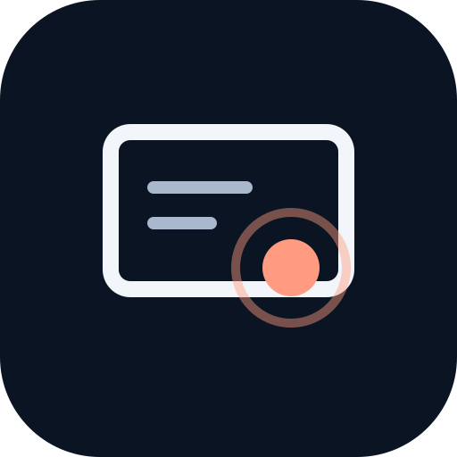
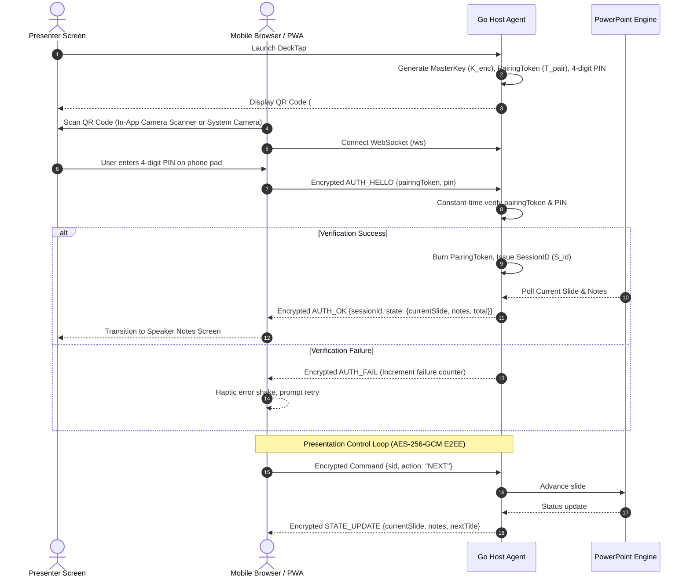

# DeckTap — Zero-Trust E2EE Presentation Remote & Notes Reader

<p align="center">
  
</p>

<p align="center">
  <a href="https://github.com/silva324/DeckTap/actions/workflows/ci.yml"></a>
  <a href="https://github.com/silva324/DeckTap/releases"></a>
  <a href="https://golang.org"></a>
  <a href="LICENSE"></a>
  <a href="https://buymeacoffee.com/carlossilva"></a>
</p>

> **DeckTap** is a modern, cross-platform presentation remote, speaker notes reader, and virtual laser pointer with **Zero-Trust End-to-End Encryption (AES-256-GCM)**, **Anti-Shoulder-Surfing PIN verification**, and **instant zero-install pairing**. Control your slides with confidence directly from your phone.

---

## ✨ Features at a Glance

| Category | Capability | Description |
| :--- | :--- | :--- |
| 🛡️ **Zero-Trust Security** | **E2EE (AES-256-GCM)** | All slide notes, titles, and remote commands are encrypted end-to-end. Master keys are passed strictly out-of-band via URI `#fragment` ([RFC 3986](https://tools.ietf.org/html/rfc3986#section-3.5)) and are never visible to servers or tunnels. |
| 🔒 **Anti-Shoulder-Surfing** | **Visual PIN Verification** | A 4-digit PIN displayed exclusively on the presenter's laptop screen prevents audience members from capturing or hijacking pairing QR codes. Rate-limited after 5 attempts. |
| 🌐 **Zero-Config Networking** | **Autonomous Edge Tunnel** | Automatically downloads, verifies, and deploys `cloudflared` for immediate worldwide access without port-forwarding or public IPs. Seamless local LAN fallback. |
| 💻 **Native Host GUI** | **Embedded Window & Tray** | Native macOS Menu Bar and Windows System Tray app with a clean in-app status window displaying pairing QR codes, active peers, and instant reset controls. |
| 📱 **Mobile PWA Experience** | **Smart Install & Scanner** | Installable Progressive Web App with an **in-app camera QR code scanner** (torch & lens switch), OLED dark mode, swipe gestures, and haptic feedback. |
| 🔄 **Resilient Connection** | **Deep Background Resume** | Survives phone lock, multi-app switching, and memory eviction via encrypted session resumption and dead-connection heartbeat detection. |
| 🎯 **Presenter Tools** | **Virtual Laser & Spotlight** | Full-screen macOS on-screen laser pointer and dimming spotlight overlay with 16:9 HUD, touch reticle, and slide mirroring. |
| 📝 **Speaker Notes** | **Typography & Up Next** | Distraction-free speaker notes with resizable text (`A-` / `A+`), slide index jump drawer, presentation stopwatch, and stage blackout (`B` / `W`). |
| 🚀 **Auto-Updates** | **GitHub Releases Integration**| Automatic background check against official GitHub releases with desktop update notification banners and 1-click update. |
| 🤖 **Autonomous CI/CD** | **Automated Releases** | Full matrix continuous integration, automated SemVer changelog management via `release-please`, and cross-platform packaging (`.dmg`, `.zip`, `.exe`, `.tar.gz`). |

> 🗺️ **Looking for what's coming next?** Explore planned features, multi-screen external display targeting, and our upcoming milestones in [**ROADMAP.md**](ROADMAP.md).

---

## 🔒 Cryptographic & Wire Protocol Specification (`SPEC-SEC-001`)

### 2.1 URI Format & Key Generation
```text
<TunnelOrLanBaseURL>/#<PairingToken>.<MasterKey>
```
- `MasterKey` ($K_{enc}$): 32 cryptographically secure bytes (`crypto/rand`), base64URL encoded.
- `PairingToken` ($T_{pair}$): 16 random bytes, base64URL encoded.
- `PinCode`: 4-digit numeric string (`0000`–`9999`).
- `SessionID` ($S_{id}$): 16-byte cryptographically secure session token issued post-PIN verification.

### 2.2 Wire Envelope
Every WebSocket frame in both directions is encrypted with AES-256-GCM:
```json
{
  "iv": "<12-byte IV base64url encoded>",
  "data": "<ciphertext + 16-byte GCM authentication tag base64url encoded>"
}
```

### 2.3 Handshake & Reconnection Flow


---

## 🚀 Installation & Downloads

### macOS
Download the latest **Universal `.dmg`** from [Releases](https://github.com/silva324/DeckTap/releases):
1. Download `DeckTap-*-macOS-Universal.dmg`.
2. Open the disk image and drag **DeckTap** to your `/Applications` folder.
3. When prompted on first launch, allow DeckTap automation permissions in **System Settings › Privacy & Security › Automation**.

### Windows
Download the latest **`DeckTap-*-windows-amd64.zip`** from [Releases](https://github.com/silva324/DeckTap/releases):
1. Extract the `.zip` archive.
2. Run `pptx-remote.exe` (or install via `Setup-DeckTap.exe`). It runs silently in your System Tray with no distracting command window.

### Build from Source
```bash
# Clone the repository
git clone https://github.com/silva324/DeckTap.git
cd DeckTap

# Run tests
go test ./...

# Build binary
go build -o bin/pptx-remote ./cmd/pptx-remote
```

---

## 🛠️ Usage & CLI Flags

```bash
# Standard mode (starts tunnel, opens host window & menu bar item)
./bin/pptx-remote

# Diagnostic doctor (tests cloudflared, PowerPoint permissions, and notes extraction)
./bin/pptx-remote doctor

# Local offline mode (skips tunnel; 127.0.0.1 or LAN IP)
./bin/pptx-remote -mode local

# Demo mode (runs synthetic presentation controller without PowerPoint)
./bin/pptx-remote -demo internal/pptx/testdata/demo.pptx

# Terminal only (no GUI window / tray icon, prints QR and PIN directly to console)
./bin/pptx-remote -no-tray -no-browser
```

---

## ☕ Support & Sponsorship

If DeckTap has saved your presentations and kept your speaker notes private, consider supporting continuous development and maintenance:

<p align="center">
  <a href="https://buymeacoffee.com/carlossilva" target="_blank">
    
  </a>
</p>

You can also sponsor via [GitHub Sponsors](https://github.com/sponsors/silva324).

---

## 🗺️ Roadmap & Community

- **[Product Roadmap](ROADMAP.md)**: Explore planned features like Multi-Screen External Display Targeting, Slide Visuals Mirroring, and Gyroscope Laser Pointer.
- **[Product Backlog](BACKLOG.md)**: Granular technical backlog and specification notes.
- **[Contributing Guide](CONTRIBUTING.md)**: Read how to contribute code, follow Conventional Commits for `release-please`, and submit PRs.
- **[Security Policy](SECURITY.md)**: Responsible disclosure guidelines and cryptographic boundaries.
- **[Code of Conduct](CODE_OF_CONDUCT.md)**: Contributor Covenant v2.1.

---

## 📄 License

This project is licensed under the [MIT License](LICENSE) &copy; 2026 Carlos Silva and contributors.
