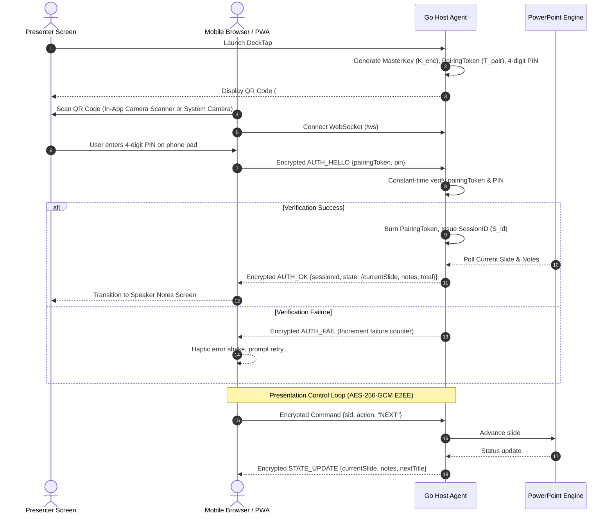

# DeckTap Architecture & Security Model

This document outlines the architectural components, cryptographic invariants, and controller bridges that power **DeckTap**.

---

## 1. System Overview

```
+-------------------------------------------------------------+
|                      Mobile Device                          |
|  - Vanilla ES6+ PWA (Embedded via go:embed)                 |
|  - Web Crypto API (AES-256-GCM, PBKDF2 / SHA-256)          |
|  - Native Touch & Gesture Engine (Pinch Zoom & Reticle)     |
+-------------------------------------------------------------+
                               |
                               | E2EE WebSocket (AES-256-GCM)
                               v
+-------------------------------------------------------------+
|                 DeckTap Host Agent (Go)                     |
|  - In-App QR & PIN Native Window                            |
|  - Session State Machine (Constant-Time PIN Verification)   |
|  - Autonomous Tunnel (cloudflared / LAN fallback)           |
+-------------------------------------------------------------+
                               |
                               | IPC / Automation
                               v
+-------------------------------------------------------------+
|                    Presentation Drivers                     |
|  - macOS: AppleScript (`osascript`) -> Microsoft PowerPoint |
|  - macOS Overlay: Cocoa Laser & Spotlight Fullscreen Window |
|  - Windows: PowerShell COM Bridge -> Microsoft PowerPoint   |
+-------------------------------------------------------------+
```

---

## 2. Cryptographic Security Specification (`SPEC-SEC-001`)

### 2.1 URI Format & Out-of-Band Key Generation
```text
https://silva324.github.io/DeckTap/#<PairingToken>.<MasterKey>
```
* **Master Encryption Key ($K_{enc}$)**: 32 cryptographically secure bytes (`crypto/rand`), base64URL encoded.
* **Pairing Token ($T_{pair}$)**: 16 random bytes, base64URL encoded.
* **Visual PIN Code**: 4-digit numeric string (`0000`–`9999`).
* **Session ID ($S_{id}$)**: 16-byte cryptographically secure session token issued post-PIN verification.

Per [RFC 3986 §3.5](https://tools.ietf.org/html/rfc3986#section-3.5), URI `#fragment` parameters are **strictly client-side** and never transmitted across HTTP requests, reverse proxies, or cloud tunnels.

### 2.2 Wire Envelope (Zero Plaintext Exposure)
All slide notes, presentation titles, slide outlines, and remote commands are encrypted client-side and host-side using **AES-256-GCM** before transmission over WebSocket:

```json
{
  "iv": "<12-byte IV base64url encoded>",
  "data": "<ciphertext + 16-byte GCM authentication tag base64url encoded>"
}
```

### 2.3 Handshake & Reconnection Flow


### 2.4 Anti-Shoulder-Surfing PIN & Rate Limiting
* Even if an unauthorized party photographs the pairing QR code from afar, they cannot connect without the **4-digit visual PIN** displayed on the presenter's laptop screen.
* Verification on the Go host uses `crypto/subtle.ConstantTimeCompare` to prevent timing attacks.
* The pairing token is rate-limited and locked after 5 failed PIN attempts, destroying the tunnel on repeated intrusion attempts.

---

## 3. Presenter Driver Safety & macOS Integration

### AppleScript Process Guard
Every AppleScript execution controlling PowerPoint verifies that PowerPoint is running prior to issuing commands:
```applescript
if application "Microsoft PowerPoint" is not running then return "0"
```
This invariant prevents AppleScript from inadvertently launching PowerPoint unprompted or hanging on IPC timeouts.

### Smart Title & Notes Extraction
* In custom PowerPoint master slide layouts, `placeholder 1` may be an image shape rather than text.
* The presenter driver inspects placeholder types (`placeholder type title`), falls back to top-of-slide text placeholders (excluding bottom footers $> 450\,\text{pt}$), and cleanses AppleScript `missing value` tokens across Go and WebUI layers.
